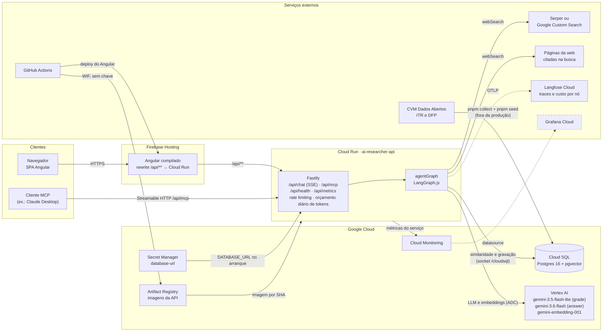
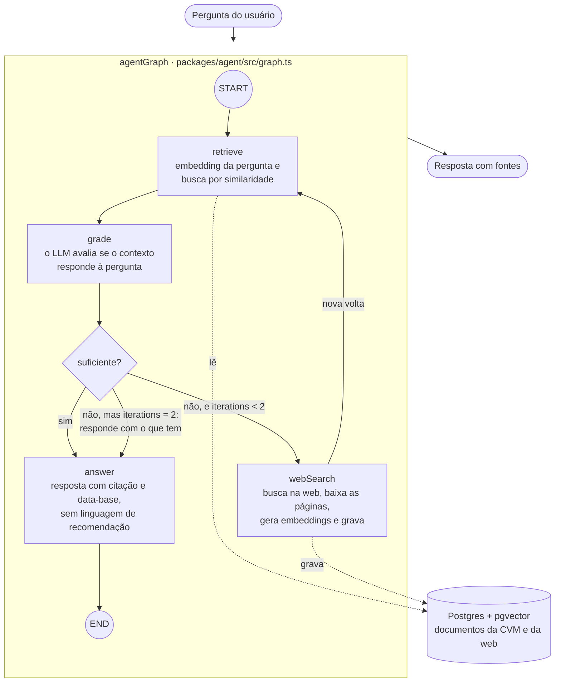
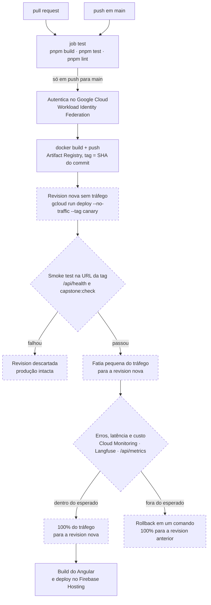

# AI Researcher

> [!IMPORTANT]
> **Este assistente apresenta informações públicas, não recomendação de investimento.**
> A consultoria de valores mobiliários é atividade regulada pela CVM. O AI Researcher informa e
> nunca recomenda: não sugere comprar, vender nem manter posição, mesmo quando a pergunta pede.
> Toda resposta cita a fonte e a data-base do dado.

Chatbot que responde perguntas sobre os indicadores financeiros de 20 empresas da B3, com dados
oficiais da CVM. Ele consulta uma base vetorial, avalia se o contexto encontrado basta para
responder e, quando não basta, busca complemento na web, grava o que encontrou e responde com a
citação de cada número.

É o projeto demonstrativo do módulo Capstone da Pós-Graduação em Engenharia AI-Native da UNIPDS. O
código é material didático: é lido linha a linha e explicado em vídeo, e cada fase do curso é uma
tag Git.

## Visão geral

- **Corpus:** formulários ITR e DFP da CVM Dados Abertos, 20 empresas × 4 trimestres = 80
  documentos. Cada empresa e trimestre vira um parágrafo gerado por template determinístico, sem
  LLM, com seis indicadores: receita líquida, lucro bruto, lucro líquido, ativo total, patrimônio
  líquido e caixa operacional.
- **Agente:** um RAG corretivo (Corrective RAG) em LangGraph.js. Perguntas que o corpus não
  responde, como o motivo de um resultado, caem na busca web, e o que ela traz fica gravado para as
  próximas perguntas.
- **Interfaces:** chat em Angular com a resposta por SSE e um painel que mostra cada etapa do grafo
  em tempo real; e um servidor MCP com a tool `perguntar`, por stdio e por HTTP.
- **Produção:** 100% Google Cloud (Cloud Run, Cloud SQL, Vertex AI), com deploy a cada push em
  `main` pelo GitHub Actions, sem nenhuma chave de service account.

| Camada | Tecnologia |
| --- | --- |
| Monorepo | pnpm workspaces + Turborepo |
| API | Fastify + TypeScript |
| Orquestração | LangGraph.js |
| Frontend | Angular 22 (standalone, signals) |
| Banco | Postgres + pgvector (Cloud SQL) |
| LLM e embeddings | Vertex AI via LangChain.js |
| Busca web | Serper ou Google Custom Search, atrás de uma interface |
| Tools | MCP (stdio + Streamable HTTP) |
| Testes | Vitest + Playwright |
| Observabilidade | Langfuse, Prometheus, Grafana Cloud |
| Deploy | Cloud Run + Firebase Hosting, via GitHub Actions |

## Arquitetura

O que está tracejado ainda não funciona em produção. A Grafana Cloud entra na tarefa G.3 do plano
(`docs/hero-project-tarefas.md`). O tracing na Langfuse já está no código, mas só liga com as
chaves `LANGFUSE_*`, que o workflow de deploy ainda não passa ao Cloud Run.



- **Firebase Hosting** serve o Angular e repassa `/api/**` ao Cloud Run. O navegador fala com uma
  origem só, e não há CORS em lugar nenhum. O `pnpm dev` (proxy do Angular) e o `docker-compose`
  (nginx) fazem o mesmo.
- **Segredos** vêm do Secret Manager; nada fica em arquivo versionado. O GitHub Actions se autentica
  no Google Cloud por Workload Identity Federation, sem chave de service account.
- **Langfuse** recebe um trace por pergunta, com tokens e custo de cada nó. Sem as chaves
  `LANGFUSE_*`, o tracing fica desligado e a API sobe igual.
- **`/api/metrics`** expõe no formato do Prometheus os tokens e o custo em USD por nó e modelo,
  contados a partir do `usage_metadata` devolvido pela Vertex AI.
- **O corpus da CVM** não é consultado em produção: `pnpm collect` gera os JSONs versionados em
  `packages/corpus/data/documentos/`, e `pnpm seed` grava-os com embeddings no pgvector.

## O agente: RAG corretivo



- **retrieve** gera o embedding da pergunta e busca os documentos mais próximos, os da CVM e os que
  a web já trouxe.
- **grade** usa o modelo mais barato (`MODEL_GRADE`) com saída estruturada: `sufficient` e o que
  falta (`missingAspects`). É o nó que mais roda, por isso o modelo leve.
- **webSearch** não passa documentos pelo estado. Grava as páginas no pgvector, e o `retrieve` as
  encontra na volta seguinte pela mesma busca. O enriquecimento fica para as próximas perguntas:
  cada página gravada vale por 7 dias, e uma pergunta parecida nesse prazo a encontra sem ir à web.
- **O laço tem limite** (`MAX_ITERATIONS = 2`): um LLM que responda sempre "insuficiente" não
  prende o grafo. Atingido o limite, o `answer` responde com o que tem e avisa que o contexto é
  parcial.
- **answer** usa o modelo de qualidade (`MODEL_ANSWER`), cita cada número com fonte e período e
  passa pelo guardrail regulatório. Um teste automatizado pergunta "devo comprar X?" e verifica que
  a resposta não tem linguagem de recomendação.

Os nós recebem as dependências por injeção (LLM, embeddings, busca, banco): com fakes no lugar, o
grafo inteiro roda nos testes, sem rede nem banco.

## Deploy canary

> [!NOTE]
> Este é o **estado-alvo** da tarefa G.6 do plano. Hoje o workflow
> (`.github/workflows/deploy.yml`) executa os passos em linha cheia e publica a revision nova direto
> com 100% do tráfego. Os passos tracejados ainda não existem.



O Cloud Run mantém as revisions anteriores. O rollback é um `gcloud run services update-traffic`
que devolve 100% do tráfego a uma delas, sem rebuild.

## Estrutura do repositório

```
apps/
  api/            Fastify: rotas, rate limiting, error handler em problem+json
  web/            Angular 22: chat, painel do grafo, disclaimer
packages/
  agent/          grafo, nós, prompts, providers, tracing e métricas
  mcp-server/     tool MCP perguntar, transportes stdio e HTTP
  contracts/      schemas zod compartilhados entre API e frontend
  corpus/         coleta da CVM, normalização e geração dos parágrafos
infra/            Dockerfiles e a documentação do Google Cloud
evals/            dataset de perguntas
scripts/          capstone:check
docs/             plano, tarefas e protótipo de design
```

`apps/*` pode importar `packages/*`; `packages/*` nunca importa `apps/*`; `contracts` não importa
ninguém.

## Como rodar localmente

Pré-requisitos: Node 24, pnpm 11 e Docker.

```bash
pnpm install
cp .env.example .env
```

**Sem credencial nenhuma (modo demo).** Com `DEMO=true` no `.env`, o grafo inteiro roda com
fixtures: responde sempre a mesma pergunta sobre a Vale no 3T25, sem Vertex AI, sem busca web e sem
banco.

```bash
pnpm dev      # API em http://localhost:3000, Angular em http://localhost:4200
```

**Com o grafo real.** Precisa de um projeto no Google Cloud com a Vertex AI habilitada e das
credenciais locais (`gcloud auth application-default login`), e de uma chave do Serper no `.env`
para a busca web.

```bash
docker compose up postgres   # Postgres + pgvector local e descartável
pnpm seed                    # grava os 80 documentos com embeddings
pnpm dev
```

A configuração do Google Cloud e do GitHub Actions para o deploy está em
[infra/README.md](infra/README.md).

## Comandos

```bash
pnpm dev              # API + web em watch
pnpm build            # build de tudo
pnpm test             # testes unitários
pnpm test:e2e         # Playwright, caminho feliz do chat em modo demo
pnpm lint             # ESLint + Prettier
pnpm collect          # coleta da CVM (só na preparação do material)
pnpm seed             # popula o pgvector a partir dos JSONs versionados
pnpm capstone:check   # verificações de produção: pnpm capstone:check --url <url>
```

## Configuração

Todas as variáveis estão documentadas no [.env.example](.env.example). As principais:

| Variável | Para quê |
| --- | --- |
| `MODEL_GRADE`, `MODEL_ANSWER`, `MODEL_EMBEDDING` | Um modelo por papel, nunca fixo no código. Trocar o de embedding exige rodar `pnpm seed` de novo. |
| `DEMO` | `true` troca o grafo inteiro por fixtures. |
| `SEARCH_PROVIDER`, `SERPER_API_KEY` | Provedor da busca web. |
| `RATE_LIMIT_MAX`, `RATE_LIMIT_WINDOW` | Pedidos por cliente e janela em milissegundos (padrão: 30 por minuto). |
| `DAILY_TOKEN_BUDGET` | Orçamento diário de tokens; esgotado, o `/api/chat` responde 429 até a meia-noite UTC. |
| `LANGFUSE_PUBLIC_KEY`, `LANGFUSE_SECRET_KEY`, `LANGFUSE_BASE_URL` | Tracing na Langfuse; sem as chaves, fica desligado. |

## Servidor MCP

A tool `perguntar` responde com o mesmo grafo e o mesmo guardrail do chat.

- **HTTP:** `POST /api/mcp`, na mesma porta da API.
- **stdio:** `pnpm build` e depois, na configuração do cliente MCP, o comando
  `node packages/mcp-server/dist/stdio.js`, com as mesmas variáveis de ambiente da API.

## Licença

[MIT](LICENSE)
