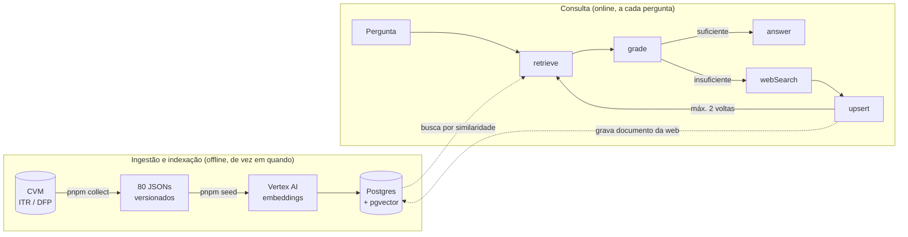
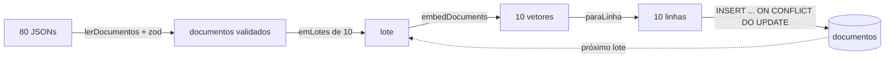

# O fluxo do RAG no AI Researcher

> Material de estudo. O objetivo não é descrever o código linha a linha, e sim explicar **por que** cada peça existe, o que daria errado sem ela e como verificar que funciona. Cada seção aponta para os arquivos reais do repositório.
>
> **Legenda:** ✅ pronto e testado · 🔜 planejado (ainda não existe no código).

---

## Sumário

1. [O problema que o RAG resolve](#1-o-problema-que-o-rag-resolve)
2. [Visão geral: duas metades](#2-visão-geral-duas-metades)
3. [Ingestão: da CVM ao parágrafo](#3-ingestão-da-cvm-ao-parágrafo) ✅
4. [Indexação: embeddings, pgvector e seed](#4-indexação-embeddings-pgvector-e-seed) ✅
5. [Consulta: o grafo Corrective RAG](#5-consulta-o-grafo-corrective-rag) ✅ / 🔜
6. [Qualidade: como saber que funciona](#6-qualidade-como-saber-que-funciona)
7. [Produção: ambientes, segredos e custo](#7-produção-ambientes-segredos-e-custo)
8. [Armadilhas que encontramos](#8-armadilhas-que-encontramos)
9. [Glossário](#9-glossário)
10. [Mapa de arquivos](#10-mapa-de-arquivos)
11. [Perguntas para revisão](#11-perguntas-para-revisão)

---

## 1. O problema que o RAG resolve

Um LLM sozinho não sabe a receita da Vale no 3T25. Quando perguntado, ele faz uma de duas coisas, e as duas são ruins:

- **inventa um número plausível** (alucinação). Em finanças, um número errado com aparência de certo é pior que nenhum número;
- **responde com dado velho**, do que viu no treinamento, sem dizer de quando é.

**RAG** (*Retrieval-Augmented Generation*, geração aumentada por recuperação) resolve isso mudando a pergunta que o LLM responde. Em vez de "qual a receita da Vale?", ele recebe:

> "Com base **neste texto** (que veio da CVM, com fonte e data), qual a receita da Vale?"

O LLM deixa de ser a fonte do fato e passa a ser só quem **lê e redige**. A fonte é a base de dados, que nós controlamos, versionamos e auditamos.

Este projeto vai um passo além do RAG simples: ele **avalia se o que encontrou basta** e, quando não basta, busca na web. Isso se chama **Corrective RAG** ([seção 5.1](#51-por-que-corrective-rag-e-não-rag-simples)).

---

## 2. Visão geral: duas metades

Todo RAG profissional tem duas metades que rodam em momentos diferentes:



| Metade | Quando roda | Custo | O que pode dar errado |
|---|---|---|---|
| **Offline** (ingestão + indexação) | quando o corpus muda | uma vez: 80 embeddings, centavos | dado errado entra na base e contamina **todas** as respostas futuras |
| **Online** (consulta) | a cada pergunta | por pergunta: 1 embedding + 1–3 chamadas de LLM | resposta errada **uma** vez |

A consequência prática: **a qualidade de um RAG se decide mais na metade offline do que na online.** Um prompt excelente não salva um documento que não contém o dado (vimos isso acontecer, [seção 3.4](#34-o-parágrafo-determinístico)).

---

## 3. Ingestão: da CVM ao parágrafo

✅ Código em [packages/corpus/](../packages/corpus/).

### 3.1 A fonte: uma só, estruturada

**CVM Dados Abertos**, formulários **ITR** (trimestral) e **DFP** (anual), de 20 empresas da B3 em 8 setores. São ZIPs anuais com CSVs no plano de contas padronizado da CVM.

Por que **uma** fonte **estruturada**, e não PDFs de release ou sites de notícia:

| Fonte estruturada única | Alternativa (PDF, HTML, várias fontes) |
|---|---|
| números já em tabela, com código de conta | extração de tabela de PDF, que erra dígito e vírgula |
| um calendário fiscal, uma moeda, um padrão contábil | conciliação entre padrões e datas diferentes |
| reprodutível: o mesmo ZIP dá o mesmo número | cada coleta pode dar um resultado diferente |
| licença aberta | direitos de uso a verificar |

A regra geral: **o texto indexado deve derivar de dado estruturado sempre que possível.** Extrair número de texto livre é a maior fonte de erro silencioso em RAG financeiro.

### 3.2 A coleta: o que os CSVs da CVM escondem

[packages/corpus/src/collect/select-quarters.ts](../packages/corpus/src/collect/select-quarters.ts) concentra a parte difícil. Quatro detalhes que só aparecem com dado real:

1. **O código de conta não é estável entre setores.** Bancos têm uma árvore de DRE/BPP diferente da industrial, e até dois bancos divergem na posição do lucro líquido. Receita (`3.01`), lucro bruto (`3.03`), ativo total (`1`) e caixa operacional (`6.01`) são estáveis; **lucro líquido e patrimônio líquido são buscados pelo texto** da conta (`DS_CONTA`), não pelo código.
2. **Consolidado ou individual.** Usa o consolidado quando existe. A Sendas (Assaí) só publica o individual, então o coletor cai para ele.
3. **O fluxo de caixa é acumulado no ano.** O ITR do 3T traz o caixa de janeiro a setembro. O caixa **do trimestre** é `acumulado(set) − acumulado(jun)`.
4. **Não existe ITR do 4º trimestre.** O 4T é derivado: `DFP anual − acumulado até setembro`. Por isso o 4T não tem o comparativo com o mesmo trimestre do ano anterior (a "cláusula YoY").

A janela é **os 4 trimestres mais recentes com cobertura de pelo menos 75% das empresas**. Um trimestre com poucas empresas publicadas (o 3T26 tinha 12 de 20 na época da coleta) é pulado, em vez de entrar pela metade.

### 3.3 A normalização: converter uma vez, num lugar só

[packages/corpus/src/normalize/to-canonical.ts](../packages/corpus/src/normalize/to-canonical.ts)

- A CVM publica **em milhares de reais**. A conversão para reais acontece **uma única vez**, em `paraReais`. Se ela acontecesse em dois lugares, cedo ou tarde alguém multiplicaria por mil duas vezes.
- É também a **fronteira de nomes**: os tipos internos da coleta são camelCase (`receitaLiquida`); o documento gravado é snake_case (`receita_liquida`), que é o contrato com o seed, o banco e as avaliações.

### 3.4 O parágrafo determinístico

[packages/corpus/src/paragraphs/template.ts](../packages/corpus/src/paragraphs/template.ts)

Cada empresa e trimestre vira **um parágrafo autocontido**, gerado por **template**, nunca por LLM:

> No 1T26, a Magazine Luiza S.A. reportou receita líquida de R$ 9,2 bilhões, queda de 2,0% frente ao 1T25 e queda de 17,5% frente ao 4T25. O lucro bruto foi de R$ 2,8 bilhões. O lucro líquido foi de R$ -55,2 milhões, com margem líquida de -0,6%. O caixa gerado nas operações somou R$ 4,5 bilhões. Ao fim do trimestre, o ativo total era de R$ 36,7 bilhões e o patrimônio líquido, de R$ 11,3 bilhões.

**Por que transformar números em texto?** Porque a busca semântica e o LLM trabalham com **texto**. Uma linha de tabela (`MGLU|1T26|9205731000|...`) gera um embedding pobre e obriga o LLM a adivinhar o significado de cada coluna. O parágrafo diz o que cada número é, em linguagem natural.

**Por que template, e não LLM?**

| Template | LLM gerando o texto |
|---|---|
| mesma entrada, mesma saída, byte a byte (há teste para isso) | pode variar a cada execução |
| custo zero | custo por documento |
| **impossível alucinar**: o número do texto é o número do dado | pode arredondar, trocar ou inventar um número |

Detalhes do template que importam:

- **Comparação ausente é omitida, nunca aproximada.** O trimestre mais antigo da janela não tem o anterior (sem cláusula "frente ao trimestre anterior"); o 4T não tem o do ano anterior (sem cláusula YoY). O texto simplesmente não diz, em vez de dizer algo errado.
- **Fluxo × posição.** Receita, lucros e caixa são do **período**; ativo e patrimônio são uma **foto no fim** dele ("Ao fim do trimestre..."). A redação deixa a diferença explícita.

> ⚠️ **Lição real deste projeto: o que não está no texto não existe para o RAG.**
>
> A primeira versão do template trazia receita, lucro líquido, margem e caixa, mas **não** trazia ativo total, patrimônio líquido nem lucro bruto. Esses valores estavam nas colunas do banco, mas o LLM só lê o parágrafo. Resultado: as perguntas "qual o patrimônio líquido do BB?" (A05) e "qual o ativo total do Itaú?" (A10) eram classificadas como **sem resposta** e iam para a web, com o dado certo guardado no banco.
>
> A correção foi no corpus, não no prompt: os seis indicadores entraram no texto, os parágrafos foram regerados e o seed rodou de novo. O `grade` passou de 7/8 para 20/20 no dataset.

### 3.5 Chunking: um documento, um chunk

Em RAG sobre documentos longos (manuais, contratos), o texto é quebrado em pedaços ("chunks") antes de virar embedding, porque um embedding representa mal um texto muito longo, e o LLM tem limite de contexto.

Aqui **não há fragmentação**: cada parágrafo já é uma unidade completa e pequena (~400 caracteres), sobre **uma** empresa em **um** trimestre. Quebrar o parágrafo separaria a receita da empresa e do período a que ela se refere.

> Regra geral: **o chunk ideal responde sozinho a uma pergunta.** Quando o dado de origem permite desenhar o documento assim, como aqui, não há o que fragmentar.

### 3.6 Metadados: para que servem

Todo documento carrega `ticker`, `company_name`, `setor`, `period`, `period_end`, `source_url` e `fetched_at`. Eles não entram no embedding, mas sustentam três funções:

| Função | Quem usa | Exemplo |
|---|---|---|
| **Citação com data-base** | nó `answer` 🔜 | "Fonte: CVM, ITR 1T26 (encerrado em 2026-03-31)" |
| **Ordenação e filtro** | `answer` 🔜, buscas futuras | escolher o "último trimestre" por `period_end`, não pela ordem da busca |
| **Expiração** | `upsert` dos documentos da web 🔜 | notícia da web vence; dado da CVM não |

### 3.7 Coleta ≠ carga: o snapshot versionado

```
pnpm collect   # acessa a CVM; só na preparação do material
pnpm seed      # lê os JSONs versionados; qualquer um roda
```

Os 80 JSONs em [packages/corpus/data/documentos/](../packages/corpus/data/documentos/) são o **snapshot** (janela 3T25–2T26). Eles são versionados; os ZIPs da CVM, não.

Separar as duas etapas dá **reprodutibilidade**: o dataset de avaliação foi escrito contra esse snapshot, e qualquer pessoa obtém a mesma base. Rodar `pnpm collect` de novo buscaria trimestres mais novos e quebraria o dataset. Por isso, quando o template mudou, os parágrafos foram **regerados a partir do snapshot**, sem nova coleta, e o diff confirmou que só o campo `paragraph` mudou.

---

## 4. Indexação: embeddings, pgvector e seed

✅ Código em [packages/agent/src/db/](../packages/agent/src/db/) e [packages/agent/src/seed/](../packages/agent/src/seed/).

### 4.1 O que é um embedding

Um **embedding** é uma lista de números (um vetor) que representa o **significado** de um texto. Textos com significado parecido viram vetores que apontam para direções parecidas.

```
"receita da Vale no 3T25"            → [0.012, -0.031, 0.044, ...]   (768 números)
"No 3T25, a Vale S.A. reportou..."   → [0.010, -0.029, 0.047, ...]   ← direção parecida
"No 1T26, a Klabin S.A. reportou..." → [-0.020, 0.015, 0.003, ...]   ← direção diferente
```

A busca semântica é: transformar a pergunta em vetor e achar os documentos cujos vetores estão **mais próximos**. Ela encontra "receita líquida" quando a pergunta diz "faturamento", algo que uma busca por palavra-chave não faz.

**Modelo:** `gemini-embedding-001`, na Vertex AI, com o nome vindo da variável `MODEL_EMBEDDING`, nunca fixo no código.

**Dimensão: 768.** O modelo gera 3072 dimensões por padrão, mas permite pedir menos (é treinado para que os primeiros números concentrem o significado, a técnica chamada *Matryoshka*). Pedimos 768 porque o índice HNSW do pgvector **não indexa vetores com mais de 2000 dimensões**. Menos dimensões também significam menos espaço e buscas mais rápidas, com perda pequena de qualidade.

> ⚠️ **Trocar o modelo ou a dimensão invalida o índice inteiro.** Vetores de modelos diferentes não são comparáveis: é como medir distância entre coordenadas de mapas diferentes. Trocou, roda o seed do zero.

### 4.2 O schema

[packages/agent/src/db/schema.ts](../packages/agent/src/db/schema.ts) · migration em [packages/agent/migrations/](../packages/agent/migrations/)

| Coluna | Tipo | Por quê |
|---|---|---|
| `id` | `uuid` | chave própria da linha |
| `ticker`, `period` | `text` | identificam o documento; **índice único** em `(ticker, period)` |
| os seis indicadores | `bigint` | o ativo de um banco passa de R$ 3 trilhões, além do limite do `integer` |
| `receita_mesmo_trimestre_ano_anterior` | `bigint`, nula | ausente no 4T |
| `paragraph` | `text` | o que vira embedding e o que o LLM lê |
| `source_url`, `fetched_at`, `period_end` | metadados | citação e data-base |
| `embedding` | `vector(768)` | o vetor; nulo até o seed rodar |

A migration é gerada pelo `drizzle-kit` a partir do schema. Ela tem **uma linha acrescentada à mão**, `CREATE EXTENSION IF NOT EXISTS vector`, porque o `drizzle-kit` não gera extensões, e num banco novo o tipo `vector` não existiria.

### 4.3 O índice HNSW e o operador de distância

Comparar a pergunta com **todos** os vetores (busca exata) funciona com 80 documentos, mas não com 8 milhões. O **HNSW** (*Hierarchical Navigable Small World*) é um índice de **vizinhos aproximados**: monta um grafo em camadas em que cada vetor se liga aos seus vizinhos, e a busca "navega" por esse grafo, de longe para perto, visitando uma fração pequena dos vetores. Troca um pouco de exatidão (pode perder um vizinho, raramente) por muita velocidade.

```sql
CREATE INDEX documentos_embedding_idx ON documentos
  USING hnsw (embedding vector_cosine_ops);
```

**`vector_cosine_ops` é o ponto crítico.** O índice é construído para **um** operador de distância e só acelera consultas que usam **esse** operador:

| Operador | Distância | Usa este índice? |
|---|---|---|
| `<=>` | cosseno | ✅ sim |
| `<->` | euclidiana (L2) | ❌ não, varre a tabela inteira |
| `<#>` | produto interno negativo | ❌ não |

**Por que cosseno?** Ele mede o **ângulo** entre os vetores e ignora o tamanho. Para texto, o que importa é a direção (o assunto), não a "intensidade" do vetor. Além disso, vetores com dimensão reduzida não vêm normalizados, e o cosseno não é afetado por isso.

**Como ler a distância de cosseno:** `0` = mesma direção (idêntico); quanto menor, mais parecido. Vai de 0 a 2.

**Verificado no projeto** (com `SET enable_seqscan = off`, para forçar o Postgres a mostrar se *consegue* usar o índice):

```
ORDER BY embedding <=> $1   →  Index Scan using documentos_embedding_idx   ✅
ORDER BY embedding <-> $1   →  Seq Scan on documentos                        ❌
```

> Nota honesta: com 80 linhas, o Postgres **prefere** ler a tabela inteira, porque é mais rápido do que abrir o índice. O índice passa a ganhar com milhares de linhas. O teste acima prova que a consulta está **escrita** para usar o índice quando ele valer a pena.

Os parâmetros do HNSW ficam nos padrões do pgvector (`m = 16`, `ef_construction = 64`, `hnsw.ef_search = 40`). Para 80 documentos, não há o que ajustar; com uma base grande, eles controlam o equilíbrio entre velocidade e *recall*.

### 4.4 O seed

[packages/agent/src/seed/run.ts](../packages/agent/src/seed/run.ts)



Quatro decisões, cada uma com um motivo:

**1. Validação com zod na fronteira** ([documento.ts](../packages/agent/src/seed/documento.ts)). Arquivo lido do disco é dado de fora. O schema confere formato de período (`1T26`), data ISO, URL e inteiros. Um JSON no formato antigo (camelCase) é recusado **apontando o arquivo**, em vez de virar uma linha com colunas vazias.

**2. Lotes de 10, e o que isso significa de verdade.** O `gemini-embedding-001` na Vertex aceita **um texto por requisição**, e o `VertexAIEmbeddings` do LangChain dispara as requisições de um lote **em paralelo**. Então o lote é **controle de concorrência**: 10 chamadas simultâneas, um `INSERT` de 10 linhas, e só então o próximo lote. Nem 80 de uma vez (estouraria cota), nem uma por vez (lento). Medido: 80 documentos em ~14 s.

**3. Upsert idempotente.** `INSERT ... ON CONFLICT (ticker, period) DO UPDATE`: rodar o seed de novo **atualiza** em vez de duplicar. Verificado: depois de duas execuções, continuam 80 linhas, e o `id` da VALE 3T25 é o mesmo.

**4. `null` explícito, nunca `undefined`.** Num upsert, `undefined` significa "não mexa nesta coluna", e o valor antigo ficaria. O comparativo YoY ausente vira `null` para ser **apagado** de verdade.

**O cliente de embeddings é injetável** ([embeddings.ts](../packages/agent/src/seed/embeddings.ts)). `criarEmbeddings()` cria o cliente real; o `semear` aceita outro por parâmetro. O modo DEMO 🔜 vai passar um fake, sem rede e sem credencial.

---

## 5. Consulta: o grafo Corrective RAG

### 5.1 Por que Corrective RAG, e não RAG simples

O **RAG simples** sempre faz: buscar → responder. Ele responde mesmo quando a busca trouxe documentos irrelevantes, e aí o LLM ou inventa, ou responde à pergunta errada.

O **Corrective RAG** põe um juiz no meio:

```
retrieve → grade → [suficiente]   → answer
                 → [insuficiente] → webSearch → upsert → retrieve (no máximo 2 voltas)
```

A base deste projeto **só tem números**, por decisão de projeto. Isso cria uma fronteira nítida, fácil de demonstrar:

| Tipo de pergunta | Caminho |
|---|---|
| quanto, quando, comparação numérica | o corpus responde |
| por que, notícia, guidance, previsão | busca na web |
| devo comprar, vender, manter? | recusa pelo guardrail |

### 5.2 Convenções dos nós

Todos os nós seguem a skill [langgraph-node](../.claude/skills/langgraph-node/SKILL.md). As que mais importam para entender o código:

**O nó é uma factory.** `makeRetrieveNode(deps)` roda **uma vez**, na montagem do grafo, e recebe as dependências; ela devolve a função `retrieve(state)`, que roda **a cada pergunta**. As dependências ficam guardadas por *closure*.

```ts
// produção
makeRetrieveNode({ embeddings: criarEmbeddings(), buscar: (v, k) => buscarDocumentosSimilares(db, v, k) })
// teste
makeRetrieveNode({ embeddings: { embedQuery: async () => [0.1] }, buscar: async () => [docFake] })
```

Isso existe porque o LangGraph chama todo nó com **um** argumento, o estado. Sem a factory, a única forma de o nó alcançar a Vertex e o banco seria importá-los diretamente, e aí nenhum teste rodaria sem rede.

**O nó declara só o que usa, por extenso.** Em vez de depender do tipo enorme do LangChain, cada nó escreve o contrato mínimo:

```ts
export interface EmbeddingsClient {
  embedQuery(texto: string): Promise<number[]>;
}
```

O cliente real da Vertex já tem esse método e se encaixa sem adaptação; o fake implementa só ele. Quem lê o nó entende a dependência sem abrir nenhuma biblioteca.

**O nó lê e devolve só um pedaço do estado.** Recebe o que precisa; devolve um objeto parcial (`{ documents }`), que o LangGraph mescla ao estado. Um campo só entra no estado se **mais de um nó** o usa. Por isso o `topK` é opção da factory, e não campo do estado.

**O nó nunca decide a rota.** O `grade` produz `sufficient`; quem escolhe entre `answer` e `webSearch` é a aresta condicional 🔜.

### 5.3 `retrieve` ✅

[packages/agent/src/nodes/retrieve.ts](../packages/agent/src/nodes/retrieve.ts) · [packages/agent/src/db/retrieve-similar.ts](../packages/agent/src/db/retrieve-similar.ts)

```ts
const embedding = await embeddings.embedQuery(state.question); // texto → vetor
const documents = await buscar(embedding, topK);               // vetor → top-5 documentos
return { documents };
```

O SQL gerado pelo Drizzle (`cosineDistance`):

```sql
SELECT id, ticker, company_name, period, period_end, paragraph, source_url, fetched_at,
       embedding <=> '[...]' AS distance
FROM documentos
WHERE embedding IS NOT NULL
ORDER BY embedding <=> '[...]'
LIMIT 5;
```

- **A pergunta e os documentos usam o mesmo modelo de embedding.** Comparar vetores de modelos diferentes não faz sentido ([4.1](#41-o-que-é-um-embedding)).
- O resultado (`RetrievedDoc`) carrega o `paragraph` (o que o LLM vai ler) e os metadados de citação.

**Resultados reais**, com embeddings da Vertex sobre os 80 documentos:

| Pergunta | 1º resultado | Distância |
|---|---|---|
| "Qual foi a receita líquida da Vale no 3T25?" | VALE 3T25 | 0,109 |
| "A Magazine Luiza teve lucro líquido positivo no 1T26?" | MGLU 1T26 | 0,116 |
| (o próprio vetor da VALE 3T25) | VALE 3T25 | 0,000 |

**Por que top-5?** Uma pergunta comparativa ("Petrobras × Vale no 1T26") precisa de pelo menos dois documentos; uma pergunta de variação ("subiu do 3T25 para o 4T25?") também. Cinco cobre esses casos com folga, sem encher o contexto do LLM de documentos irrelevantes.

### 5.4 `grade` ✅

[packages/agent/src/nodes/grade.ts](../packages/agent/src/nodes/grade.ts) · [packages/agent/src/prompts/grade.ts](../packages/agent/src/prompts/grade.ts)

O `grade` responde a uma pergunta só: **estes documentos respondem esta pergunta?**

**Saída estruturada, validada à vista.** A resposta do LLM decide a rota do grafo, então ela **não pode** ser texto livre interpretado com `includes('sim')`. O nó pede ao modelo um objeto com schema e, depois, valida ele mesmo:

```ts
const gradeResultSchema = z.object({
  sufficient: z.boolean(),
  missingAspects: z.array(z.string()),
});

const classificador = llm.withStructuredOutput(gradeResultSchema); // uma vez, na factory
// a cada pergunta:
const { sufficient, missingAspects } = gradeResultSchema.parse(await classificador.invoke(prompt));
return { sufficient, missingAspects, iterations: 1 };
```

- `withStructuredOutput` faz o modelo responder no formato do schema.
- O `parse` explícito garante que, se o modelo devolver algo fora do schema, o erro aparece **aqui**, e não como uma rota errada três nós depois. Há teste para isso.
- `iterations: 1` é um **incremento**, não um total: o estado soma (`prev + next`), e a aresta usa o total para parar o laço.

**O prompt** é curto e tem uma regra central: o contexto **só tem números**, então pergunta qualitativa (motivo por trás de um número, notícia, fato relevante, guidance, posicionamento de mercado, previsão de preço) é **sempre insuficiente, mesmo que o documento seja da empresa certa**.

É essa regra que faz o Corrective RAG aparecer em aula: para "por que a receita da Vale caiu?", o `retrieve` traz exatamente os documentos da Vale, com a queda escrita neles. Um juiz ingênuo diria "suficiente". O correto é "insuficiente: falta o **motivo**".

> **Por que tão curto? Porque medimos.** Uma versão com quatro regras explícitas (critério de suficiente, "cálculos e comparações contam", comparação com um lado em falta, formato do `missingAspects`) parecia mais robusta. Corremos as duas nas mesmas 20 perguntas, com os mesmos documentos recuperados, o mesmo modelo e a temperatura 0: **20/20 as duas**, e a versão longa era 25% maior num nó que corre em cada volta do laço. Ficou a curta.
>
> A lição vale para qualquer prompt: **uma regra só entra com uma pergunta que a exija.** Regra "por precaução" custa tokens em toda chamada e não se sabe se ajuda. A ressalva honesta é que 20 perguntas numa só execução é uma amostra pequena; quando aparecer uma pergunta que falhe, ela vai para o dataset, e aí sim a regra entra.

**Resultado real** (`gemini-3.5-flash-lite`, temperatura 0, `retrieve` real), em todas as perguntas dos grupos A e B do [dataset](../evals/dataset.json):

| Grupo | Esperado | Acertos | Exemplo de `missingAspects` |
|---|---|---|---|
| A (quantitativo) | suficiente | **12/12** | — |
| B (qualitativo) | insuficiente | **8/8** | "motivo da queda da receita da Vale no 1T26" |

### 5.5 Aresta condicional e guard de iteração 🔜

```ts
graph.addConditionalEdges('grade', (state) => {
  if (state.sufficient) return 'answer';
  if (state.iterations >= MAX_ITERATIONS) return 'answer'; // 2
  return 'webSearch';
});
```

- A decisão vive **na aresta**, lendo o que o `grade` produziu, sem reavaliar nada.
- **Sem o guard, o grafo pode entrar em laço:** a busca web não acha o que falta, o `grade` diz insuficiente de novo, e assim por diante, gastando dinheiro a cada volta.
- Estourar o limite **não é erro**: o grafo segue para `answer`, que deve avisar que o contexto é parcial.

### 5.6 `webSearch` e `upsert` 🔜

Planejado no bloco D (tarefas D.6 e D.7):

- **`SearchProvider`**, uma interface com duas implementações (Google Custom Search e Serper), trocáveis por variável de ambiente. Aqui a interface se justifica: há **dois** usos concretos desde o início.
- Os resultados são extraídos, divididos em chunks (texto da web é longo, ao contrário do corpus) e **gravados na mesma tabela** com `upsert`, com metadados de origem e **validade (TTL)**: notícia envelhece, dado da CVM não.
- Depois do upsert, o grafo **volta ao `retrieve`**. A mesma busca por similaridade passa a encontrar o documento novo. É por isso que a função de busca não distingue CVM de web: para ela, todo documento é um vetor na tabela.
- O enriquecimento **persiste**: a próxima pessoa que fizer uma pergunta parecida encontra o documento já na base, sem nova busca na web.

### 5.7 `answer` e o guardrail regulatório 🔜

Planejado na tarefa D.9:

- **Citação obrigatória com data-base.** Toda resposta diz de onde veio o número e de quando ele é (`source_url`, `period`, `period_end`).
- **"Último trimestre" se resolve pelos metadados.** Na pergunta A02 ("lucro do Itaú no último trimestre disponível"), a busca trouxe primeiro ITUB 3T25 e 4T25, não o 2T26. A palavra "último" não carrega informação temporal para o embedding: os trimestres do Itaú ficam todos próximos da pergunta, em ordem praticamente aleatória. O `answer` precisa escolher pelo `period_end`, não pela ordem de similaridade.
- **Guardrail: o sistema informa, nunca recomenda.** Consultoria de valores mobiliários é atividade regulada pela CVM. O prompt do `answer` proíbe sugestão de compra, venda ou manutenção, e um **teste obrigatório** envia "devo comprar X?" e verifica a ausência de linguagem recomendatória. O `grade` não trata isso: para "qual ação vai subir?" (C05) ele responde "insuficiente", corretamente, e quem barra é o `answer`.
- Modelo próprio, `MODEL_ANSWER` (`gemini-3.6-flash`): mais capaz que o do `grade`, porque precisa acertar a citação e o guardrail. O `grade` roda em toda volta do laço e faz uma classificação simples, então usa o modelo mais barato.

### 5.8 Streaming e interface 🔜

`POST /api/chat` com **SSE** (tarefa D.10), para a resposta aparecer enquanto é gerada, e um painel no Angular mostrando por quais nós a pergunta passou. O mesmo caminho `/api/**` que hoje serve o `/api/health`: proxy no desenvolvimento, nginx no compose, rewrite do Firebase em produção.

---

## 6. Qualidade: como saber que funciona

### 6.1 Três níveis de verificação

| Nível | O que prova | Rede/banco? | Onde |
|---|---|---|---|
| **Teste unitário com fake** | a lógica do nó: o que ele pede, o que devolve, o que recusa | não | `*.test.ts`, no CI |
| **Checagem de tipos contra o cliente real** | que o `ChatVertexAI` e o `VertexAIEmbeddings` encaixam nos contratos escritos à mão | não | `tsc` |
| **Execução real com o dataset** | que o **prompt** e o **modelo** acertam | sim, custa centavos | manual, antes de considerar o nó pronto |

O primeiro nível é obrigatório e roda em todo push. Ele **não** prova que o prompt funciona: um fake devolve o que mandamos. Por isso o terceiro nível existe, e foi ele que encontrou o problema do parágrafo incompleto ([3.4](#34-o-parágrafo-determinístico)).

**O que vale testar com fake** (exemplos reais do `grade.test.ts`):
- o prompt enviado contém a pergunta e o parágrafo de cada documento;
- a saída estruturada é configurada **uma vez**, não a cada pergunta;
- uma saída do LLM fora do schema é **recusada**.

### 6.2 O dataset de avaliação

[evals/dataset.json](../evals/dataset.json): 27 perguntas, revisadas por humano, amarradas ao snapshot do corpus.

| Grupo | Quantas | O que testa | Caminho esperado |
|---|---|---|---|
| A | 12 | números, comparações, cálculos | corpus responde |
| B | 8 | motivo, notícia, guidance, mercado | busca na web |
| C | 7 | pedido de recomendação | recusa |

Um bom dataset de avaliação tem **as três fronteiras** do sistema, inclusive os casos difíceis: "por que caiu?" com o documento certo na mão (B01), "subiu ou caiu?" sem a palavra escrita no texto (A04), comparação entre duas empresas (A03, A07, A11).

> Quando o snapshot do corpus muda, o dataset precisa ser revisto. As respostas esperadas citam números de uma janela específica.

---

## 7. Produção: ambientes, segredos e custo

**Um código, dois bancos.** A única diferença entre local e produção é o valor de `DATABASE_URL`:

| | Local | Produção |
|---|---|---|
| Banco | Postgres + pgvector do `docker-compose`, porta 5434 | Cloud SQL Postgres 16 + pgvector |
| Credencial | `postgres/postgres` no `.env` (descartável) | senha do `app_user`, **só no Secret Manager** |
| Embeddings e LLM | Vertex AI de verdade, pelo login ADC | Vertex AI de verdade, pela service account do Cloud Run |

**Nada sensível no código.** Nomes de modelo vêm de variável de ambiente (`MODEL_EMBEDDING`, `MODEL_GRADE`, `MODEL_ANSWER`). A autenticação na Vertex é por ADC, sem chave em arquivo.

**Custo por etapa** (ordem de grandeza):

| Etapa | Quando | Custo |
|---|---|---|
| seed (80 embeddings) | uma vez por mudança no corpus | centavos |
| `retrieve` (1 embedding) | toda pergunta | fração de centavo |
| `grade` (1 chamada, modelo barato) | toda volta do laço (até 3) | fração de centavo |
| `answer` (1 chamada, modelo melhor) | uma vez por pergunta | o maior custo por pergunta |
| busca na web | só quando o `grade` diz insuficiente | cota gratuita diária |

**Observabilidade 🔜** (Unidade 5): cada nó vira um *span* nomeado no Langfuse, com latência e custo próprios. É o que permite ver, numa pergunta real, quanto custou cada etapa e por que o grafo seguiu o caminho que seguiu.

---

## 8. Armadilhas que encontramos

Problemas reais deste projeto, na ordem em que apareceram. Cada um é uma lição que vale para qualquer RAG.

| Sintoma | Causa | Lição |
|---|---|---|
| campo `setor` sumiu dos documentos, sem erro | CSV com quebra de linha CRLF no Windows; o cabeçalho virou `setor\r` | valide os dados de saída da ingestão, não só a de entrada |
| A05 e A10 classificadas como "sem resposta" | ativo e patrimônio estavam no banco, mas **não no parágrafo** | **o que não está no texto não existe para o RAG** |
| pergunta sobre o Assaí trouxe a Lojas Renner | o nome oficial é **Sendas Distribuidora S.A.**; "Assaí" não aparece em nenhum texto | nomes comerciais e apelidos precisam estar no texto indexado, ou a busca não os encontra |
| "último trimestre" trouxe trimestres antigos primeiro | similaridade não entende tempo | ordem temporal se resolve com metadado (`period_end`), não com embedding |
| "lote de 10" não virou 1 requisição | o modelo aceita 1 texto por chamada; a biblioteca paraleliza | leia o que a biblioteca faz por dentro antes de documentar um comportamento |
| busca por distância euclidiana ignorou o índice | índice criado para cosseno | o operador da consulta tem que ser o do índice |

---

## 9. Glossário

| Termo | Significado |
|---|---|
| **RAG** | *Retrieval-Augmented Generation*: buscar documentos relevantes e entregá-los ao LLM junto com a pergunta |
| **Corrective RAG** | RAG com um passo de avaliação (`grade`) que aciona uma fonte alternativa quando a busca não basta |
| **Embedding** | vetor de números que representa o significado de um texto |
| **Distância de cosseno** | medida do ângulo entre dois vetores; 0 é idêntico |
| **HNSW** | índice de vizinhos aproximados em grafo de camadas; rápido, com pequena perda de exatidão |
| **pgvector** | extensão do Postgres que adiciona o tipo `vector`, operadores de distância e índices |
| **Chunk** | pedaço de texto indexado como uma unidade; aqui, um parágrafo |
| **Top-k** | os *k* documentos mais próximos da pergunta |
| **Upsert** | inserir, ou atualizar se já existir |
| **Saída estruturada** | resposta do LLM forçada a seguir um schema (JSON), em vez de texto livre |
| **Factory** | função que monta e devolve outra função já configurada com suas dependências |
| **Snapshot** | cópia congelada do corpus, versionada, contra a qual o dataset foi escrito |
| **Data-base** | a data a que um número se refere (`period_end`), diferente da data em que foi coletado (`fetched_at`) |
| **TTL** | *time to live*: prazo de validade de um documento antes de ser considerado vencido |

---

## 10. Mapa de arquivos

```
packages/corpus/                         INGESTÃO (offline)
  data/empresas.csv                      as 20 empresas: ticker, razão social, código CVM, setor
  src/collect/select-quarters.ts         escolha dos trimestres e extração das contas da CVM
  src/normalize/to-canonical.ts          milhares → reais; camelCase → snake_case
  src/paragraphs/template.ts             o parágrafo determinístico
  data/documentos/{TICKER}.json          o snapshot versionado (80 documentos)

packages/agent/                          INDEXAÇÃO E CONSULTA
  src/db/schema.ts                       tabela documentos, vector(768), índices
  migrations/                            SQL gerado pelo drizzle-kit
  src/seed/                              leitura + zod, lotes, embeddings, upsert
  src/db/retrieve-similar.ts             busca por distância de cosseno
  src/nodes/retrieve.ts                  nó retrieve
  src/nodes/grade.ts                     nó grade
  src/prompts/grade.ts                   prompt do grade

evals/dataset.json                       27 perguntas de avaliação (grupos A, B, C)
.claude/skills/langgraph-node/SKILL.md   convenções dos nós do grafo
```

---

## 11. Perguntas para revisão

Tente responder sem olhar o texto; a seção de referência está entre parênteses.

1. Por que o LLM deixa de ser a "fonte" do fato num RAG? O que passa a ser a fonte? (1)
2. Por que a qualidade de um RAG se decide mais na ingestão do que no prompt? Dê o exemplo deste projeto. (2, 3.4)
3. Por que o parágrafo é gerado por template, e não por um LLM? Cite três motivos. (3.4)
4. Por que este projeto não fragmenta os documentos em chunks? Quando você fragmentaria? (3.5)
5. O que acontece se você trocar o modelo de embedding sem rodar o seed de novo? (4.1)
6. Por que 768 dimensões, e não as 3072 padrão do modelo? (4.1)
7. Uma consulta com `ORDER BY embedding <-> $1` está lenta numa base grande. Qual é a causa provável? (4.3)
8. Por que o seed usa `null`, e não `undefined`, para o comparativo YoY ausente? (4.4)
9. Por que o nó é uma factory? O que impediria o teste sem ela? (5.2)
10. "Por que a receita da Vale caiu?" traz exatamente os documentos da Vale. Por que o `grade` deve dizer "insuficiente"? (5.4)
11. Por que o `grade` valida com zod mesmo usando `withStructuredOutput`? (5.4)
12. O que impede o grafo de buscar na web para sempre? O que acontece quando o limite é atingido? (5.5)
13. Como o sistema deve responder "qual o lucro no último trimestre?", se a busca trouxe primeiro um trimestre antigo? (5.7)
14. Um teste com LLM fake passou. Isso prova que o prompt funciona? Como você verificaria? (6.1)
